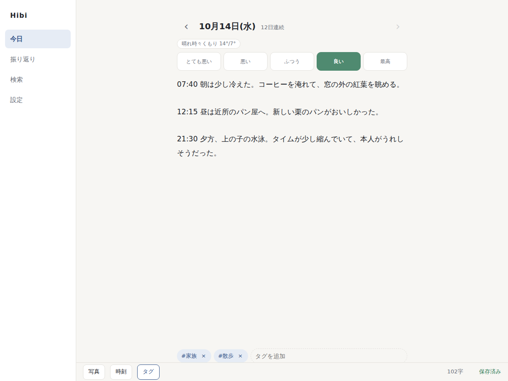

# Hibi

WordPress に、日記を書くためだけのアプリを足すプラグインと、それをサイトのトップページにするテーマです。開くといきなり今日の日記が出て、そのまま書き始められます。

- **プラグイン `hibi-journal`**：これだけで動きます。どのテーマでも `/journal/` で日記アプリが開きます。データ、REST API（`hibi/v1`）、アプリの画面（PWA）、写真、検索、通知、書き出し・取り込み
- **テーマ `hibi`**（任意）：アプリをサイトのトップページにし、画面を `/calendar/` のようにサイト直下に置きます



## できること

- 1日1ページ。日付の区切りは朝4時（深夜に書いても前の日の日記になる。設定で変更可）
- 開いた瞬間に書ける。保存ボタンはなく、入力が止まって1.5秒で自動保存。日本語の変換中は保存しない
- オフラインで書いた内容は端末（IndexedDB）に保存し、接続が戻ったら送る
- 別の端末で同じ日を書き換えていたら、上書きせずに「この端末の内容／もう一方／両方」を選ばせる
- 気分（5段階）、タグ、その日の天気（Open-Meteo）、写真
- カレンダー（点の色が気分、大きさが文字数）、年間のヒートマップ、タイムライン、全文検索、1年前の今日
- 書いていない日だけ、決めた時刻に1回届くリマインダー（Web Push）
- すべてを ZIP（JSON、日ごとの Markdown、写真）で書き出し、同じ形式で取り込み
- 画面は翻訳可能（英語・日本語同梱）。表示言語はユーザーの言語設定に従う

## プライバシー

- 日記は常に「非公開」の投稿として保存し、他のユーザーからは見えません
- 写真は Web サーバーが直接配信しないフォルダに置き、ログインと持ち主を確認してから返します。保存時に再エンコードし、位置情報（GPS）を消します
- サイト全体のログイン必須は、別のプラグイン [Takumi Private Gate](https://github.com/moriyama-dev/takumi-private-gate) に任せています
- 暗号化はしていません

## 動作環境

- WordPress 6.6 以上、PHP 8.1 以上
- HTTPS（Service Worker、通知、現在地の取得に必要）
- PHP 拡張：`openssl`、`gmp` または `bcmath`（通知）、`zip`（書き出し・取り込み）、`imagick`（HEIC の写真。無くても JPEG / PNG / WebP は扱える）
- サーバーの cron から5分ごとに `wp hibi send-reminders` を実行（リマインダー）

## リポジトリの構成

```
plugin/          プラグイン hibi-journal
  app/src/       アプリのソース（TypeScript + Preact + Vite）
  assets/app/    ビルド済みのアプリ
  vendor-prefixed/  web-push とその依存（名前空間を Hibi\Vendor に付け替え済み）
theme/           テーマ hibi（トップページをアプリにするだけの薄いテーマ）
tests/php/       PHPUnit
tests/e2e/       Playwright
bin/             開発用スクリプト
docs/            進捗の記録、本番への反映手順
```

## 開発

```bash
npm install
composer install                 # リポジトリ直下：PHPUnit
bin/prefix-vendor.sh             # プラグインの web-push を入れて名前空間を付け替える

npm run build                    # plugin/app/src → plugin/assets/app
npm run dev                      # 変更を監視してビルド
```

`plugin/` と `theme/` を、開発用 WordPress の `wp-content/plugins/hibi-journal` と `wp-content/themes/hibi` にシンボリックリンクして使います。

### テスト

```bash
bin/install-wp-tests.sh          # WordPress のテスト環境を ~/.cache に用意（専用のテスト用 DB が必要）
vendor/bin/phpunit               # PHPUnit

npx playwright install chromium
npx playwright test              # E2E（PC とスマホの画面サイズ）
```

接続先は環境変数 `HIBI_BASE_URL` で指定します（初期値は `http://localhost`）。例：`HIBI_BASE_URL=http://192.168.0.10 npx playwright test`

E2E は、テーマ `hibi` が有効な開発用サイトに対して、専用のユーザー `hibi-e2e` で動き、終わったらそのユーザーごと消します。開発用サイトが http でも Service Worker を試せるよう、Chromium に安全な接続として扱う設定を渡しています。

### WP-CLI

```bash
wp hibi seed --days=3000         # テスト用ユーザー hibi-seed に日記を生成
wp hibi seed --clean             # そのユーザーと日記を削除
wp hibi export --user=<ログイン名> --file=journal.zip
wp hibi import journal.zip --user=<ログイン名>
wp hibi send-reminders           # 時刻を過ぎた未記入のユーザーに通知
```

### 配布用の zip

```bash
bin/build.sh                     # dist-zip/ にプラグインとテーマの zip を作る
```

## ライセンス

GPLv2 以降。同梱しているライブラリのライセンスは `plugin/vendor` と `theme/readme.txt` を参照してください。
